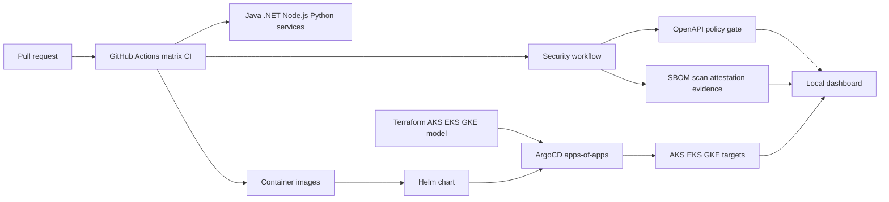
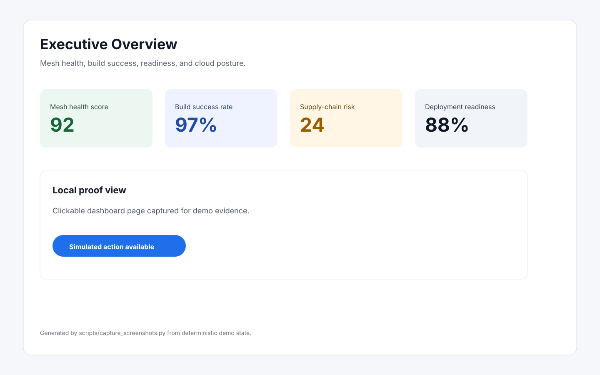
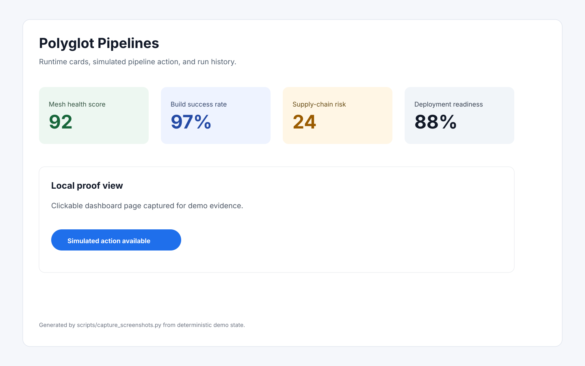
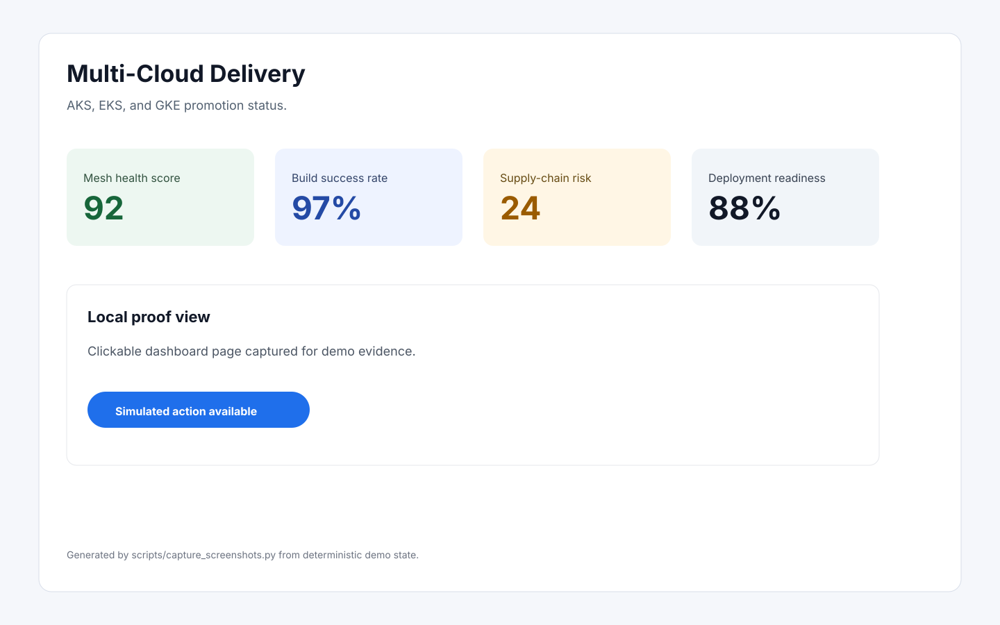
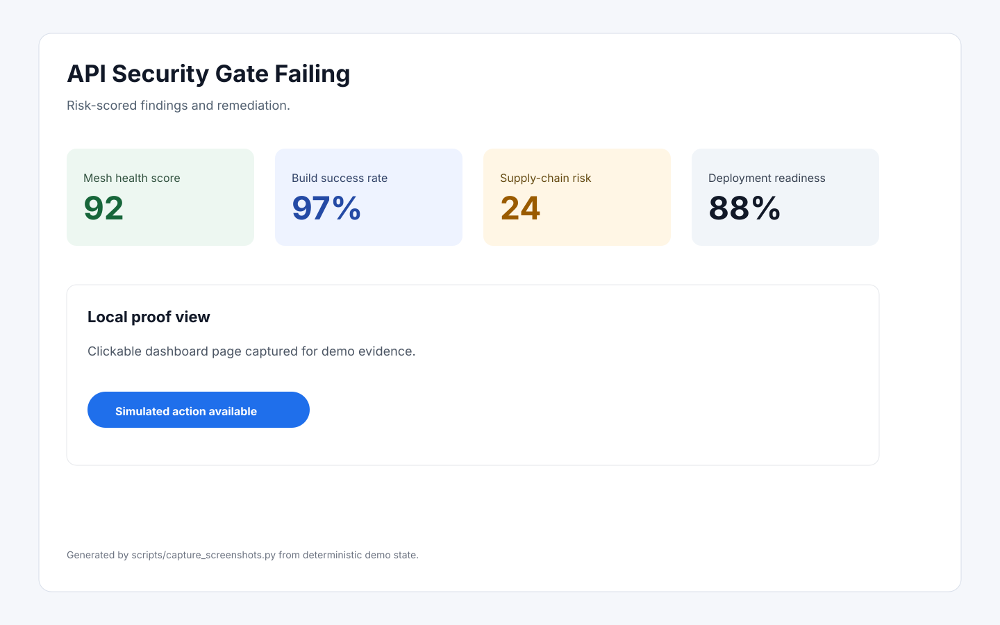
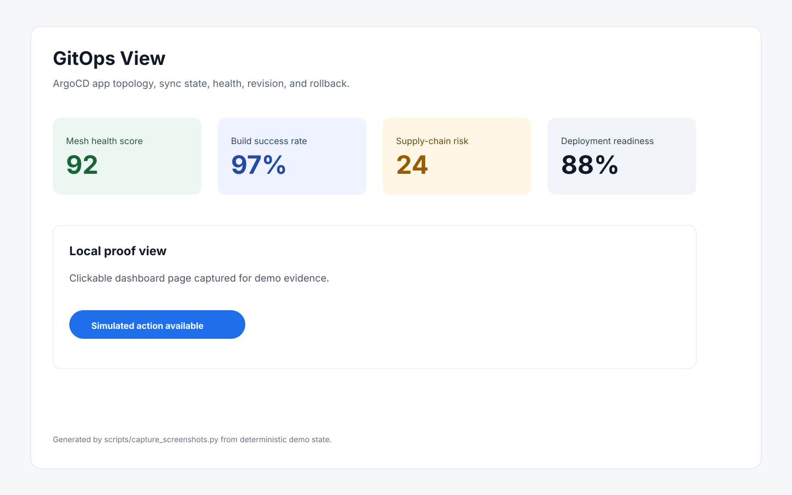
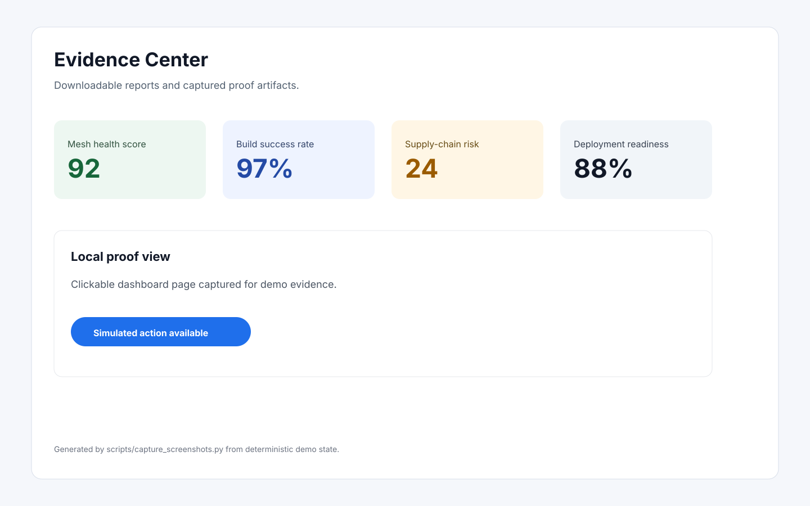

# Polyglot CI/CD Mesh

Polyglot CI/CD Mesh is a local-first proof of concept for enterprise platform engineering: Java, .NET, Node.js, and Python services move through secure CI, API policy validation, supply-chain evidence, Terraform-modeled AKS/EKS/GKE targets, Helm packaging, and ArgoCD GitOps delivery. The default demo is safe and local; the production path is documented for OIDC-based cloud rollout.

## Why This Exists

Many CI/CD portfolio projects describe a modern platform but stop before they can be clicked, tested, or demonstrated. This repository is built to show the full shape of the system: runnable services, a working policy gate, a dashboard, evidence artifacts, reproducible tests, and deployment manifests that technical stakeholders can inspect.

## Architecture



## Features

- Four real service folders with health/version endpoints, OpenAPI specs, Dockerfiles, and unit-test surfaces.
- Python FastAPI API policy gate with pass/fail validation, risk score, evidence, and remediation.
- Clickable React, Vite, TypeScript, and Tailwind dashboard backed by a Python API.
- Local evidence generation for tests, OpenAPI gate results, SBOM summary, scan summary, Terraform validation, and security posture.
- GitHub Actions split into CI, security, release, and Terraform validation workflows with minimal permissions.
- Terraform modules for AKS, EKS, GKE, registry, and observability that validate locally.
- Helm chart and ArgoCD app-of-apps/ApplicationSet examples for GitOps delivery.
- Automated screenshot asset generation into `docs/screenshots/`.

## Local Quickstart

```bash
make install
make test
make demo
```

Open:

- Dashboard UI: http://localhost:5173
- Dashboard API: http://localhost:8080
- API policy gate: http://localhost:8090

The default path uses deterministic local state and does not create cloud resources.

## Demo Workflow

1. Run `make demo`.
2. Open the dashboard.
3. Review Executive Overview for mesh health, build rate, readiness, security gate, supply risk, and AKS/EKS/GKE posture.
4. Open Polyglot Pipelines and run a simulated pipeline for a service.
5. Open Multi-Cloud Delivery and promote from dev to prod.
6. Open API Security Gate, test the compliant spec, then test the non-compliant spec.
7. Open Supply Chain to show SBOM, scan, attestation, signing, failing dependency, and remediation.
8. Open GitOps View and run a simulated rollback.
9. Open Evidence Center and download JSON evidence.

## Screenshots










Generate or refresh screenshots:

```bash
make screenshots
```

## Security Model

The default demo avoids long-lived cloud secrets. Workflows use scoped permissions and document OIDC for AWS, Azure, and GCP production deployment. API changes pass through the local OpenAPI policy gate. Supply-chain evidence includes SBOM, scan summary, attestation readiness, and image signing readiness.

See [docs/security-model.md](docs/security-model.md) and [docs/threat-model.md](docs/threat-model.md).

## CI/CD Workflows

- `.github/workflows/ci.yml`: matrix build/test/image build for Java, .NET, Node.js, and Python.
- `.github/workflows/security.yml`: dependency review, OSV, Trivy, SBOM, OpenAPI policy gate, and security evidence.
- `.github/workflows/terraform-validate.yml`: Terraform fmt/init/validate, TFLint, and Checkov.
- `.github/workflows/release.yml`: release image build, SBOM, signing evidence, and release evidence bundle.

## Terraform And Multi-Cloud

Terraform models the multi-cloud control plane with modules for AKS, EKS, GKE, registry, and observability. The local validation path does not provision cloud resources. The production path replaces local module internals with real resources and authenticates through OIDC.

See [terraform/README.md](terraform/README.md).

## GitOps Model

ArgoCD uses a root app, per-service Applications, sync waves, and an ApplicationSet for AKS/EKS/GKE targets. Helm values separate runtime settings and environment settings.

## API Security Gate

Run the gate directly:

```bash
python scripts/validate_openapi.py security-gates/openapi-rules/compliant-api.yaml
python scripts/validate_openapi.py security-gates/openapi-rules/non-compliant-api.yaml
```

The non-compliant sample intentionally fails with findings for missing auth, missing rate limit, missing Tyk policy mapping, wildcard public admin exposure, and traceability gaps.

## Supply-Chain Security

Local evidence is generated with:

```bash
python scripts/generate_demo_data.py
```

Reports are written to `evidence/` and surfaced in the dashboard Evidence Center.

## Testing

```bash
make test
make demo-check
make validate
```

The practical local suite covers policy validation, dashboard API behavior, repository contract, compose surfaces, evidence generation, and frontend smoke checks. Runtime-specific Java and .NET tests are executed when their tools are available.

## Roadmap

- Replace local Terraform module internals with real AKS, EKS, and GKE resources.
- Add keyless container signing in release jobs.
- Publish SBOM and provenance to an artifact store.
- Add live ArgoCD API integration behind the simulated GitOps view.
- Add Kubernetes admission policy examples.

## Known Limitations

- The default demo is local and simulated for cloud and registry state.
- Real cloud deployment requires account setup, OIDC roles, environment approvals, DNS, and registry permissions.
- Screenshot generation writes deterministic visual proof assets when browser automation is unavailable.

## Safe Demo Disclaimer

The default path is local and safe. It does not create cloud resources, does not require paid services, and does not require long-lived cloud credentials.
