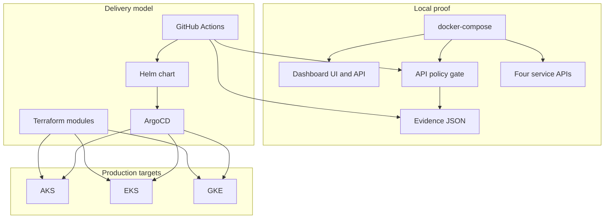

# Architecture

The platform is split into local proof components and production-ready extension points. The local path proves behavior without cloud spend. The production path keeps the same boundaries and replaces simulations with managed services.

## Component Flow

## Local Path

The local path starts with `make install`, `make test`, and `make demo`. Demo data is deterministic, stored in `evidence/`, and served through the dashboard API. The dashboard exposes executive status, pipeline simulation, multi-cloud promotion, API policy validation, supply-chain posture, GitOps rollback simulation, and evidence downloads.

## Production Path

The production path keeps the same workflows and folder boundaries:

- GitHub Actions builds and tests each runtime.
- Security workflow blocks critical dependency, container, IaC, and OpenAPI findings.
- Terraform provisions cloud resources after protected approvals.
- Helm packages service deployments.
- ArgoCD reconciles service state into AKS, EKS, and GKE.
- Gateway policy maps OpenAPI security controls to Tyk policy identifiers.

## Data Boundaries

No default local command requires cloud credentials. All real cloud identities are documented as OIDC federation targets and should be scoped per environment.
